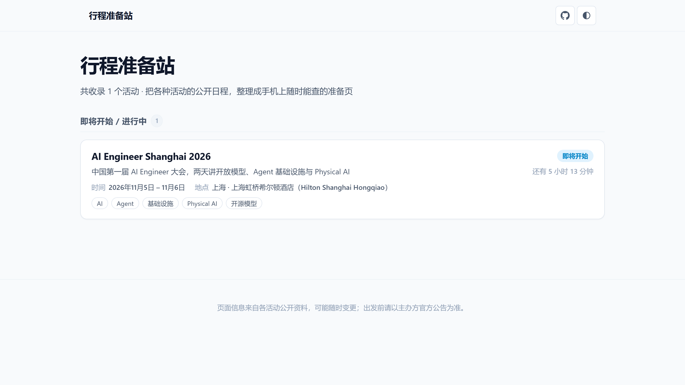
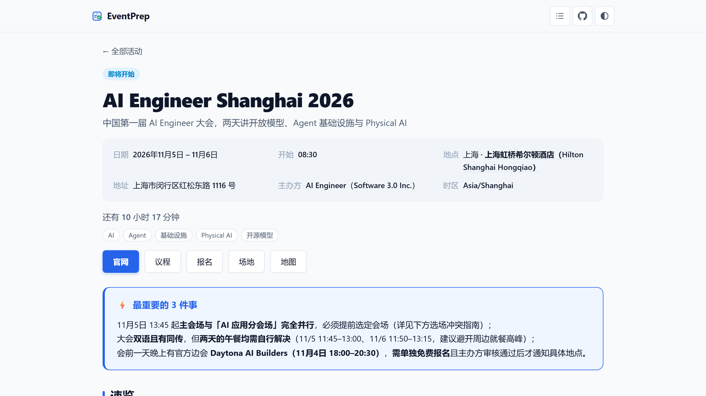

# EventPrep

> 把各种活动的公开日程，整理成手机上随时能查的准备页。离线可用，不存数据。

[](LICENSE) [](https://github.com/rockbenben/365opensource)

[▶ 在线预览](https://event.newzone.top/) · [🧩 加一个活动](#加一个活动) · [📖 调研技能](skills/event-research/SKILL.md) · [给开发者](#给开发者)



看到想参加的活动，官网往往只有一张长图海报或一份翻不动的 PDF 日程——站在会场门口不知该听哪场、哪些事得提前办。这个站点把公开日程解析成一页随身准备手册：场次卡片按天排布、讲者与术语背景就地展开、定制角色推荐路线，并将行前提醒做成可离线打勾的清单。

## 支持范围

| 方面 | 支持情况 |
| --- | --- |
| 适用类型 | 会议、峰会、展会、演出、赛事、培训、出游——凡是有公开日程的活动均可 |
| 活动内容 | YAML front matter + Markdown，一个活动一个独立目录与 `event.md` |
| 时区换算 | 任意 IANA 时区（如 `Asia/Shanghai`），严格按活动所在地换算自然日与倒计时 |
| 屏幕适配 | 移动端（390px 竖屏）至桌面端（1280px+）；单场卡片占满整行，免去横向滚动 |
| 现代浏览器 | Chrome、Edge、Safari、Firefox；自动适配深浅色外观，支持手动切换 |
| 部署托管 | 纯静态产物：支持 GitHub Pages、EdgeOne Pages、腾讯云 COS、Cloudflare Pages |
| 运行环境 | Node.js ≥ 22.18；构建期 3 个运行时依赖，零前端框架，零付费外部 API |
| 界面语言 | 简体中文（针对国内线下参会场景深度优化） |

## 能做什么

- **会场动线排布**：页面按现场使用顺序自上而下呈现——倒计时 → 最重 3 件事 → 速览 → 场次卡片 → 角色路线 → 离线清单，无多余空壳。
- **场次就地闭环**：一场一张完整卡片；讲者履历与术语要点收拢为原生小图标，点击即可展开，信息就地闭环无需往返跳转。
- **访问时刻动态计算**：客户端根据打开时刻实时计算活动状态与倒计时，昨日构建的静态页面在今天打开依然准确显示「进行中」。
- **倒计时锚在真实开场时刻**：开始时间从议程首场推出（几点签到、几点开场），不是当天零点——前一天晚上看到的「还有 3 小时」，指的是你该到场的那一刻。
- **离线行前清单**：参会待办项直接在手机浏览器内打勾，状态保存在本地 LocalStorage，会场网络拥堵甚至断网时照常可用。
- **折叠状态接续**：日程按天、推荐路线按条折叠，行前清单默认收起。你改过的折叠方式记在本地，下次打开还是那样；已经过去的日程天还会自己收起来，眼前只剩今天要看的。
- **一键打印版**：页头点「打印版」，所有折叠内容一次摊开、交互控件全部藏掉，只留纸面上要读的东西——存成 PDF 带去会场也行。
- **阅读进度接续**：活动页会记住你上次读到哪一节，下次打开直接回到原处——散场路上掏出手机，不用再翻找。
- **角色路线与冲突提示**：依不同参会角色智能规划推荐场次，直观标出同时间段并行的分会场冲突，消除选场焦虑。
- **AI 调研与双向 Markdown**：内置信源穿透技能，输入官方/票务链接自动产出标准 `event.md`；页面自带源文件下载，改完塞回即生效。

## 快速开始

### 1. 在线使用

1. 打开在线站点（[event.newzone.top](https://event.newzone.top/)），在首页按「即将开始 / 日期待定 / 已结束」快速浏览。
2. 点进具体活动（如 [AI Engineer Shanghai 2026](content/2026-11-ai-engineer-shanghai/event.md)），在手机或电脑上查看完整议程与行前清单。

### 2. 本地预览与构建

```bash
npm install
npm run build             # 解析 content/ 并在 dist/ 生成静态站点
npm run preview           # 启动本地预览服务器（http://localhost:4173/）
```

想先体验效果或运行端到端验收测试（使用 `examples/` 占位数据，不污染正式内容）：

```bash
npm run build:examples
npm run preview -- --out dist-examples
```

## 怎么用

### 加一个活动

所有活动内容均存放在 `content/<slug>/event.md`，一个目录对应一个活动。`slug` 建议采用 `YYYY-MM-活动名` 格式便于按时间排序。

运行内置脚手架快速生成骨架文件：

```bash
npm run new -- 2026-11-ai-engineer --title "AI Engineer Summit 2026"
```

生成的 `event.md` 结构如下：

```markdown
---
title: AI Engineer Summit 2026
summary: 面向工程团队的 AI 落地大会
start: 2026-11-05
end: 2026-11-06
timezone: Asia/Shanghai
city: 上海
venue: 国家会展中心
venue_url: https://example.org/venue
address: 青浦区崧泽大道 333 号
tags: [AI, 工程实践]
---

> **最重要的 3 件事**：主论坛为英文并设同传；「Agent 工程」分会场需单独预约；凭报名二维码在南厅签到。

## 速览

## 日程

### Day 1 · 2026-11-05（周四）主题一句话

#### 10:30–11:15 · 工程实践
- 形式: 演讲
- 会场: 主会场
- 讲者: 张某某 | 某某科技 | assets/speakers/zhang.webp | 基础设施负责人 | 某某科技基础设施负责人，本次主讲多模态生成视频的空间定位。
- 状态: 讲者待确认
- 备注: 先搞懂 KV-Cache：大模型推理时缓存注意力键值的机制，直接影响首字延迟与并发成本。
- 看点: 工具调用失败之后的重试与幂等，是生产环境 Agent 最容易出故障的一环。

## 推荐路线

## 行前清单
- [ ] 提前在官网选好同声传译语言通道
```



#### 关键书写要点
- **日程采用卡片语法而非表格**：一天一个 `###`，一场一个 `#### 时间 · 标题`，下方接显式字段列表（`形式` / `会场` / `讲者` / `时长` / `状态` / `看点` / `摘要` / `备注` / `出处`）。
- **信息就地闭环**：不设独立的「机构与嘉宾」和「前置知识」章节。讲者履历直接写在讲者行第 5 段（渲染为讲者名后的小图标）；术语与准备事项写入 `- 备注:`（渲染为暖色提示图标）。
- **未定事项即时标注**：单场待定事项（如主题待确认、讲者待定）直接写在该场的 `- 状态:` 字段，构建期自动渲染为警示标签。
- **场地提供官方链接**：填写 `venue` 时建议同步填写 `venue_url`，手机折叠头部将生成直达按钮。
- **格式校验**：保存后运行 `npm run check`，字段拼写或层级错误会直接精确提示行号。

### 使用内置 AI 技能自动调研

无需人工逐字整理复杂的官方官网或长图海报。项目内置了 `event-research` 调研技能，提供活动链接即可自动穿透官方多层信源并输出合规的 `event.md`：

- 查阅完整调研流程：[skills/event-research/SKILL.md](skills/event-research/SKILL.md)
- 查证与写作手册：[skills/event-research/references/writing-guide.md](skills/event-research/references/writing-guide.md)

### 双向编辑与导出

每个活动页右下角均提供原始 Markdown 下载链接。亦可使用命令行直接导出源文件：

```bash
npm run export -- 2026-11-ai-engineer-shanghai > event.md
```

导出的内容是完整的 Markdown 源文件（含 YAML front matter）。交给 AI 工具修改润色后，放回 `content/<slug>/event.md` 重新构建即可直接生效。

### 静态托管与部署

推送 `main` 分支会自动触发 GitHub Actions 工作流 [deploy.yml](.github/workflows/deploy.yml)，执行单元测试、完成静态页面渲染，并将全量产物推送到 `gh-pages` 分支：

- **GitHub Pages**：进入仓库 Settings → Pages → Build and deployment → Source 选择 `Deploy from a branch`，分支选择 `gh-pages` / `/ (root)`。
- **EdgeOne Pages**：新建项目，Git 仓库分支指定 `gh-pages` 即可。

三引擎浏览器验收（Chromium / Firefox / WebKit）由 [ci.yml](.github/workflows/ci.yml) 承担，是**合并闸门**：它跑在 PR 上，布局回归由它报。发布本身不等待它——那会把「每次推 main 跑两遍完全相同的验收」的时间翻倍，却拦不住更多东西（同一个 commit、同一份代码）。

缓存与安全响应头由 [`public/edgeone.json`](public/edgeone.json) 决定，它随产物一起进 `gh-pages` 分支根目录，EdgeOne 从那里读取。样式表与脚本按**内容哈希**命名（`site.6297e662.css`），所以改了样式就是新文件名，可以放心长期缓存而不必担心用户拿到旧版本。

可在仓库 Settings → Secrets and variables → Actions → Variables 配置自定义变量：

| 变量 | 作用说明 |
| --- | --- |
| `SITE_URL` | 站点根路径（例如 `https://event.newzone.top` 或 `/<仓库名>/`），用于生成 canonical、og:url 和 og:image 绝对链接。留空则不写入这几项 meta |
| `CNAME` | 自定义域名（例如 `event.newzone.top`）。设置后会自动写入 `gh-pages` 分支根目录的 `CNAME` 文件 |

## 限制

- **静态快照非实时通知**：页面内容为构建时的信息快照，若主办方临场调换议程，请以现场大屏幕及主办方官方即时公告为准。
- **行前清单本地保存**：勾选记录仅保存在当前设备的浏览器 LocalStorage 中，清理浏览器缓存或切换设备不会自动同步。
- **折叠状态本地保存**：日程各天、推荐路线各条、行前清单的展开与收起同样只存在当前设备的浏览器里（换设备不会同步）。
- **阅读进度本地保存**：活动页会记住你上次读到哪一节，同样只存在当前设备的浏览器里（换设备不会同步）。滚动回页面顶部即视为本次读完，浏览器中的记录会自动清除。
- **缺省时区按 UTC 显示**：若活动未指定时区，系统将回退为 UTC 并明确标注「按 UTC 计算」，不假定活动所在地时区。
- **公开仓库内容安全**：`content/` 目录下的所有文件均会公开开源，切勿写入门票二维码、身份证号、手机号等个人隐私数据。
- **调研技能受反爬影响**：自动调研依赖外部票务和活动方接口，如遇强反爬拦截，技能会如实说明未获取字段而不会伪造内容。

## 给开发者

```text
src/
├── cli.ts              # build / check / new-event / export / preview 命令行入口
├── lib/
│   ├── timezone.ts     # IANA 时区 ↔ 绝对瞬间换算（基于原生 Intl，零第三方库）
│   ├── status.ts       # 活动状态判定、倒计时与日期格式化
│   ├── frontmatter.ts  # YAML front matter 提取与切分
│   ├── schema.ts       # 字段类型与必需性校验
│   ├── markdown.ts     # Markdown 转安全 HTML（段级接管、白名单消毒）
│   ├── agenda.ts       # 日程章节结构化解析与卡片字段校验
│   ├── events.ts       # 活动数据发现（可替换的 EventProvider）
│   ├── assets.ts       # 站点级资源的内容哈希命名（配合 CDN 长缓存）
│   └── build.ts        # 静态站点全量构建管线
├── templates/          # HTML 模板（首页、活动页、日程卡片、骨架）
└── assets/             # 样式表与轻量客户端脚本（原生 JS）

public/
└── edgeone.json        # EdgeOne Pages 的缓存与安全响应头（随产物进分支根目录）

scripts/
├── audit-ui.mjs        # Playwright 浏览器自动化验收（跨引擎、双分辨率、无损守卫）
├── screenshots.mjs     # 自动捕获 README 演示图与 1200×630 分享卡（og-image.png）
└── fetch-speakers.mjs  # 官方讲者头像批量抓取与格式转换
```

```bash
npm test            # 运行全部 Vitest 单元测试
npm run typecheck   # TypeScript 类型检查（tsc --noEmit）
npm run audit:ui    # 浏览器验收（占位数据：Chromium / Firefox / WebKit，1280px / 390px）
npm run audit:real  # 浏览器验收（正式内容：在 dist/ 上执行全量端到端验证）
```

### 设计与实现准则

- **零运行时框架**：构建为纯静态 HTML，仅依赖原生 JavaScript 完成状态重算、分类过滤与清单持久化，极速秒开。
- **绝对时间与客户端对齐**：构建期把活动自然日、IANA 时区与**议程里的时刻**（首场几点开始、末场几点结束）转换为 UTC 绝对时间戳；客户端动态计算访问时刻的状态与倒计时。双端逻辑通过 `src/test/client-parity.test.ts` 保持严格一致。
- **议程段级接管**：Markdown 管线在「段」级别识别日程章节，由 `agenda.ts` 独立解析并生成语义卡片 HTML，避免被通用 Markdown 引擎错误转义。
- **严格构建安全**：任一活动数据出错即中断构建且保留旧产物；全量 HTML 在渲染完成后经过严格的 `sanitize-html` 白名单消毒。

## 关于 365 开源计划

[365 开源计划](https://github.com/rockbenben/365opensource) 的第 **#049** 个项目——一个人 + AI，一年 300+ 个开源项目。

[提交你的需求 →](https://365.aishort.top/) · [Discord](https://discord.gg/PZTQfJ4GjX) · [Telegram](https://t.me/aishort_top)
